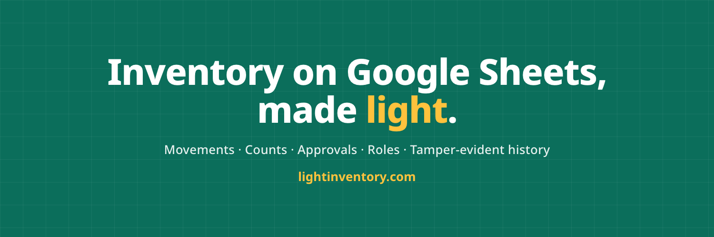

  

**LightInventory** turns the Google Sheet you already use into a complete inventory system, without the bloat or the price of traditional inventory software.

- **Your data stays in your Sheet.** We use the narrowest Google scope (`drive.file`). If you leave, you keep the file.
- **Tamper-evident history on every plan.** Every movement is recorded, verifiable and reversible. Edits made directly in the sheet are detected.
- **Built for teams:** approvals, roles scoped to locations, and passkeys/MFA for every user.
- **27 languages.**

[Website](https://www.lightinventory.com) · [X](https://x.com/LightInventory) · [LinkedIn](https://www.linkedin.com/company/145373743/) · [Crunchbase](https://www.crunchbase.com/organization/lightinventory)

Security reports: [security@lightinventory.com](mailto:security@lightinventory.com)
